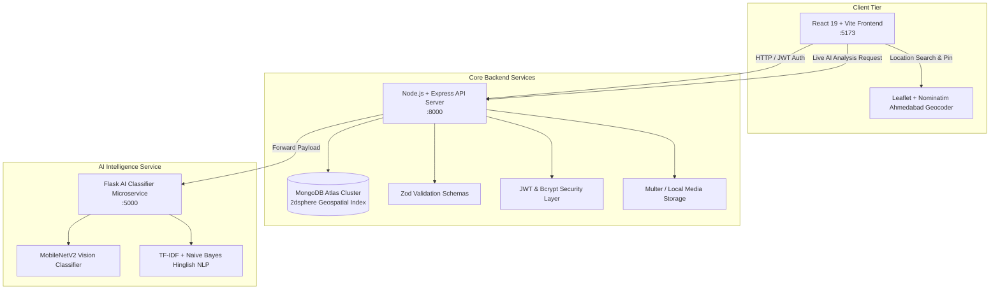

# 🏙️ FixMyCity — Ahmedabad Civic Intelligence Platform

[](https://nodejs.org/)
[](https://www.mongodb.com/atlas)
[](https://react.dev/)
[](https://flask.palletsprojects.com/)
[](https://zod.dev/)

**FixMyCity** is an end-to-end municipal issue reporting and dispatch management platform designed specifically for **Ahmedabad, Gujarat, India**.

It unites citizens and municipal engineers through automated multi-modal defect classification, intelligent topic mismatch detection, physical visual ground-truth severity assessment, role-based access control (RBAC), and strict geospatial boundary enforcement.

---

## 🏛️ System Architecture



---

## 🛠️ Technology Stack

| Layer | Technologies & Tools |
| :--- | :--- |
| **Frontend** | React 19, Vite, React Router v7, Leaflet, Axios, Vanilla CSS Modules (Glassmorphism design tokens) |
| **Backend API** | Node.js, Express.js, JWT (`jsonwebtoken`), Password Hashing (`bcryptjs`), Multer file uploads |
| **Database** | MongoDB Atlas via Mongoose with `2dsphere` geospatial indexing |
| **Validation** | Zod schemas for credentials, issue reporting, and Ahmedabad bounding box coordinates |
| **AI Microservice** | Python 3.9+, Flask, TensorFlow (MobileNetV2 ImageNet), Scikit-Learn (TF-IDF & Naive Bayes) |

---

## ⚙️ Prerequisites

Before running the project locally, ensure you have installed:
- **Node.js 18+** & **npm**
- **Python 3.9 – 3.11**
- **MongoDB Atlas** account (free cluster configured in `backend/.env`)

> [!IMPORTANT]
> **MongoDB Atlas Network Access (IP Whitelist)**:
> In your [MongoDB Atlas Dashboard](https://cloud.mongodb.com/) under **Security → Network Access**, add your current IP address (or click **Allow Access from Anywhere** `0.0.0.0/0` for development).

---

## 🚀 Quickstart Guide (Step-by-Step)

### Step 1: Install Dependencies

#### 1. Backend (Node.js)
```bash
cd backend
npm install
cd ..
```

#### 2. Frontend (React + Vite)
```bash
cd frontend
npm install
cd ..
```

#### 3. AI Service (Python)
```bash
# Windows:
.venv\Scripts\activate
# macOS/Linux:
source .venv/bin/activate

pip install -r ai_service/requirements.txt
```

---

### Step 2: Seed the Database

Seed municipal departments, demo users, and sample Ahmedabad issues into MongoDB Atlas:

```bash
cd backend
npm run seed
cd ..
```

---

### Step 3: Start the Application (3 Terminals)

#### 🟢 Terminal 1: AI Intelligence Microservice (`:5000`)
```bash
# Activate virtual environment
.venv\Scripts\activate

# Run Flask AI service
python ai_service/app.py
```
* **Status**: `http://127.0.0.1:5000/health`

#### 🔵 Terminal 2: Node.js Express Backend (`:8000`)
```bash
cd backend
npm run dev
```
* **Status**: `http://127.0.0.1:8000/api`

#### 🟣 Terminal 3: React 19 Frontend (`:5173`)
```bash
cd frontend
npm run dev
```
* **App URL**: `http://localhost:5173`

---

## 👥 User Roles & Access Control

The platform strictly enforces **Least-Privilege Role-Based Access Control (RBAC)** across three distinct tiers:

| Role | Typical Identity | Scope & Privileges |
| :--- | :--- | :--- |
| **City Administrator** | `adminuser` | Full municipal oversight, cross-department analytics, global issue assignment, and emergency escalation. |
| **Department Officer** | `officer_<dept>` | Scoped strictly to the specific department (Roads, Water, Electricity, Sanitation, Health) queue and lifecycle resolution. |
| **Citizen** | Registered users | Submit civic issues, upload photos, geolocate pins, track resolution status, and manage profile. |

> 🔒 **Deployment Security Note**: Hardcoded test passwords and quick-login bypasses have been completely removed.
> - To initialize departments and bootstrap initial administrative accounts for a fresh deployment, run:
>   ```bash
>   cd backend
>   npm run seed
>   ```
> - Initial passwords can be customized before running the seed script via `INITIAL_ADMIN_PASSWORD` and `INITIAL_OFFICER_PASSWORD` environment variables in `backend/.env`.
> - Citizens register securely with their own credentials via the `/register` portal.

---

## 🧠 Core Intelligence & Governance Features

### 1. Cross-Field & Cross-Modal Topic Mismatch Protection
- **Contradiction Detection**: If a citizen enters a title describing road potholes but a description about a burst water pipeline, the AI engine detects the conflicting topics, flags `is_mismatch: true`, and prompts the user to align their report details.
- **Strict Server Rejection**: The backend blocks mismatched or contradictory complaints with `400 Bad Request` before they enter municipal queues.

### 2. Multi-Modal Vision & NLP Triage
- Combines **MobileNetV2** visual defect recognition (60% weight) with **TF-IDF + Naive Bayes** text analysis (40% weight) to recommend the exact responsible municipal department and prioritize urgent safety hazards (e.g., exposed high-voltage cables, major pipeline ruptures).

### 3. Ahmedabad Geofencing
- Coordinate boundaries are strictly validated on both client and server to remain within the Ahmedabad metropolitan area:
  - **Latitude**: `22.95°N – 23.12°N`
  - **Longitude**: `72.45°E – 72.66°E`
- Submissions outside these boundaries are rejected by the Zod validation middleware.

### 4. Anti-Gibberish & Input Hygiene
- Rejects keyboard spam (e.g., `asdfghjk`, `123456`), repeated identical characters (`aaaa`), and nonsensical phrases to prevent database pollution.

---

## 📂 Project Directory Structure

```
fixmycity/
├── ai_service/               # Python Flask AI Classification Microservice
│   ├── app.py                # MobileNetV2 vision model & NLP inference
│   ├── models/               # Pretrained weights and vectorizers
│   ├── requirements.txt      # Python dependencies
│   └── .env                  # AI service environment variables
├── backend/                  # Node.js + Express + MongoDB REST API
│   ├── server.js             # Express application entrypoint (:8000)
│   ├── src/
│   │   ├── config/           # MongoDB Atlas connection (db.js)
│   │   ├── controllers/      # Auth, Department, and Issue controllers
│   │   ├── middleware/       # JWT auth, Multer upload, and Zod validation
│   │   ├── models/           # Mongoose schemas (User, Department, Issue)
│   │   ├── routes/           # Express API routers
│   │   ├── schemas/          # Zod validation schemas
│   │   ├── seed/             # Database seed script (seedData.js)
│   │   └── services/         # Python AI microservice bridge & keyword fallback
│   ├── media/issues/         # Uploaded citizen issue photos
│   ├── package.json          # NPM dependencies & scripts
│   └── .env                  # MongoDB Atlas URI & JWT secrets
└── frontend/                 # React 19 + Vite Web Application
    ├── src/
    │   ├── components/       # Shared UI components (Navbar, Hero, StatCard, etc.)
    │   ├── pages/            # Home, SubmitIssue, IssueTracking, AdminDashboard, Portals
    │   ├── services/         # Axios API client (`api.jsx`) & geocoding helper
    │   ├── App.jsx           # App routing & authentication synchronization
    │   └── index.css         # Glassmorphism design tokens & global typography
    ├── index.html            # Application entry HTML
    └── vite.config.js        # Vite development server configuration
```

---

## 📄 License

This project is licensed under the MIT License. Developed for civic modernization in Ahmedabad, India.
